

<picture><source media="(prefers-color-scheme: dark)" srcset="assets/en/dark/header.svg"/>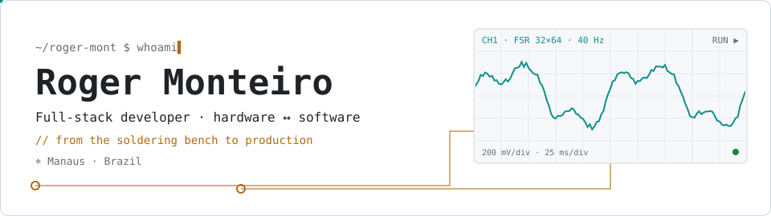</picture>

 

🇧🇷 <a href="README.md">Versão em português</a>

<picture><source media="(prefers-color-scheme: dark)" srcset="assets/en/dark/s01.svg"/>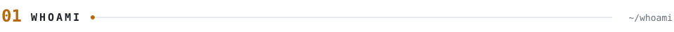</picture>

<picture><source media="(prefers-color-scheme: dark)" srcset="assets/en/dark/whoami.svg"/></picture>

<picture><source media="(prefers-color-scheme: dark)" srcset="assets/en/dark/s02.svg"/>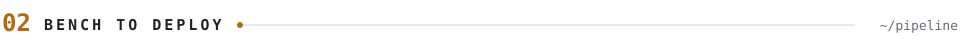</picture>

<picture><source media="(prefers-color-scheme: dark)" srcset="assets/en/dark/pipeline.svg"/>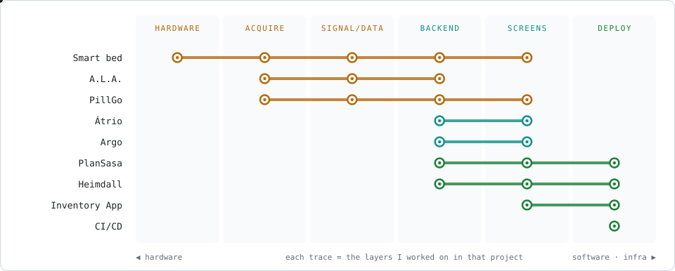</picture>

<picture><source media="(prefers-color-scheme: dark)" srcset="assets/en/dark/s03.svg"/>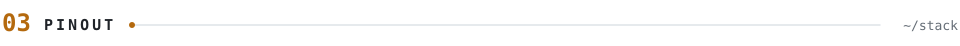</picture>

<picture><source media="(prefers-color-scheme: dark)" srcset="assets/en/dark/stack.svg"/>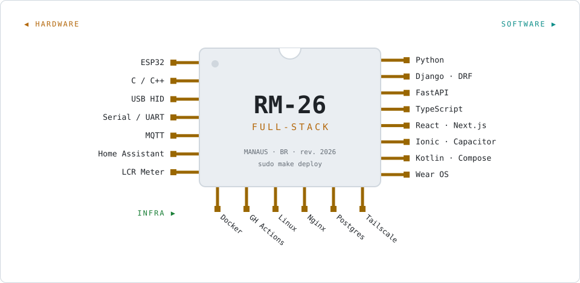</picture>

<picture><source media="(prefers-color-scheme: dark)" srcset="assets/en/dark/s04.svg"/>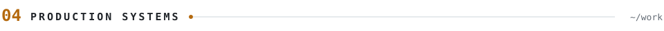</picture>

<a href="https://github.com/roger-mont/showcase-heimdall"><picture><source media="(prefers-color-scheme: dark)" srcset="assets/en/dark/card-heimdall.svg"/>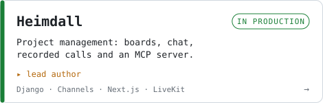</picture></a><a href="https://github.com/roger-mont/showcase-cicd"><picture><source media="(prefers-color-scheme: dark)" srcset="assets/en/dark/card-cicd.svg"/>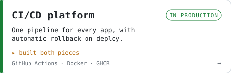</picture></a>

<a href="https://github.com/roger-mont/showcase-argo"><picture><source media="(prefers-color-scheme: dark)" srcset="assets/en/dark/card-argo.svg"/>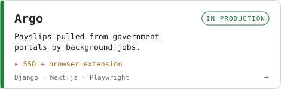</picture></a><a href="https://github.com/roger-mont/showcase-atrio"><picture><source media="(prefers-color-scheme: dark)" srcset="assets/en/dark/card-atrio.svg"/>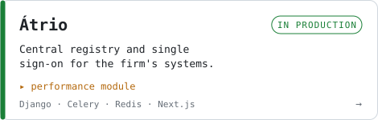</picture></a>

<picture><source media="(prefers-color-scheme: dark)" srcset="assets/en/dark/s05.svg"/>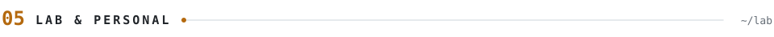</picture>

<a href="https://github.com/roger-mont/samel-project"><picture><source media="(prefers-color-scheme: dark)" srcset="assets/en/dark/card-maca.svg"/>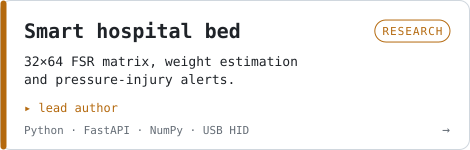</picture></a><a href="https://github.com/repo-fablab/smartpill-mobile"><picture><source media="(prefers-color-scheme: dark)" srcset="assets/en/dark/card-pillgo.svg"/>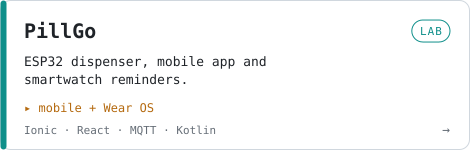</picture></a>

<a href="https://github.com/roger-mont/showcase-ala"><picture><source media="(prefers-color-scheme: dark)" srcset="assets/en/dark/card-ala.svg"/>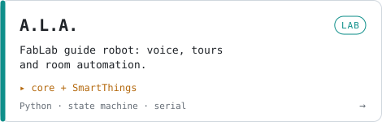</picture></a><a href="https://github.com/roger-mont/showcase-inventory-app"><picture><source media="(prefers-color-scheme: dark)" srcset="assets/en/dark/card-inventory.svg"/>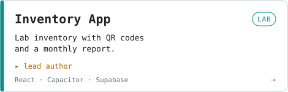</picture></a>

<a href="https://github.com/roger-mont/showcase-plansasa"><picture><source media="(prefers-color-scheme: dark)" srcset="assets/en/dark/card-plansasa.svg"/>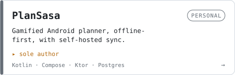</picture></a>

<picture><source media="(prefers-color-scheme: dark)" srcset="assets/en/dark/s06.svg"/>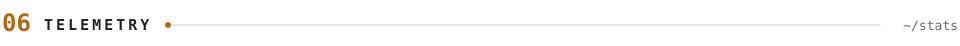</picture>

<picture><source media="(prefers-color-scheme: dark)" srcset="assets/en/dark/telemetry.svg"/>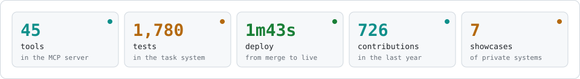</picture>

<picture><source media="(prefers-color-scheme: dark)" srcset="assets/en/dark/footer.svg"/>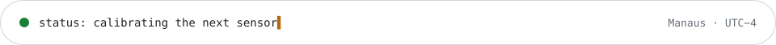</picture>

Education: software development at Trybe · each card opens the project showcase

